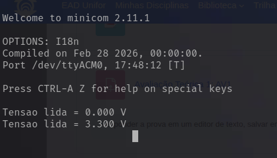

# Relatório – Prática 4: Conversor Analógico-Digital (ADC)

**Disciplina:** Sistemas de Tempo Real (STR) – Prof. Imbiriba
**Aluno:** Rafael Marins
**Plataforma:** Placa NUCLEO-F446RE (STM32F446RET6), programação bare-metal em C, STM32CubeIDE 2.2.0
**Projeto:** `workspace_2.2.0/conversor_ad`

---

## 1. Introdução

Sinais do mundo físico (temperatura, luminosidade, posição de um potenciômetro) são analógicos, enquanto um microcontrolador só processa números. O conversor analógico-digital (ADC) faz essa ponte: ele mede a tensão presente em um pino e a transforma em um valor inteiro que o programa pode usar, comparar ou enviar a outro dispositivo.

Esta prática explora o ADC1 do STM32F446 com acesso direto aos registradores (sem HAL), lendo a tensão do pino **PA1** (canal 1 do ADC1) e enviando o resultado pela porta serial (USART2, acessível no PC pela porta serial virtual do ST-LINK). A prática evolui em cinco etapas:

| Etapa | Descrição |
|---|---|
| Parte 1 | Simples conversão, com espera do fim da conversão por *polling* |
| Parte 2 | Conversão contínua, também por *polling* |
| Parte 3 | Conversão contínua com fim de conversão por **interrupção** |
| Tarefa 1 | Uma conversão simples a cada vez que o botão da placa é pressionado, fim de conversão por interrupção |
| Tarefa 2 | Igual à Tarefa 1, mas o valor é convertido para **volts** (`float`) antes de ser enviado |

## 2. Objetivos

**Objetivo geral:** compreender e configurar o ADC do STM32F446 em nível de registradores, nos modos de conversão simples e contínua, com e sem interrupção.

**Objetivos específicos:**
1. Configurar o PA1 como entrada analógica e o ADC1 para converter o canal 1.
2. Realizar conversões simples e contínuas, esperando o término por *polling* do flag EOC.
3. Habilitar a interrupção de fim de conversão (EOCIE) e tratá-la em `ADC_IRQHandler`.
4. Disparar uma conversão ao pressionar o botão B1 (PC13) e enviar o resultado pela serial (Tarefa 1).
5. Converter o valor digital em volts e enviá-lo com `printf` em ponto flutuante (Tarefa 2).
6. Validar o sistema em hardware com tensões de referência conhecidas (GND e 3,3 V).

## 3. Revisão bibliográfica

**ADC por aproximação sucessiva (SAR).** O circuito compara a tensão de entrada, mantida constante por um *sample & hold*, com a saída de um DAC interno. Um bloco de aproximação ajusta o valor do DAC bit a bit, do mais ao menos significativo, até que a saída do DAC iguale a entrada. O tempo de conversão é proporcional ao número de bits (UFOR, Prática 4).

**ADC do STM32F4.** Resolução de 12 bits, até 16 canais externos multiplexados, e modos de conversão simples, contínua, varredura (*scan*) e descontínua. O resultado fica no registrador de dados `ADC_DR`, alinhado à direita (valor nos bits 11:0) ou à esquerda (RM0383 / RM0390). Registradores usados:

| Registrador | Campo | Função |
|---|---|---|
| `RCC_AHB1ENR` | GPIOAEN, GPIOCEN | Liga o clock de GPIOA e GPIOC |
| `RCC_APB2ENR` | ADC1EN | Liga o clock do ADC1 |
| `GPIOA_MODER` | MODER1 = `11` | PA1 em modo analógico |
| `ADC_SQR3` | SQ1[4:0] | Primeiro canal da sequência (canal 1) |
| `ADC_SQR1` | L[3:0] | Tamanho da sequência menos 1 |
| `ADC_CR2` | ADON, CONT, SWSTART | Liga o ADC, conversão contínua, inicia conversão |
| `ADC_CR1` | EOCIE | Habilita a interrupção de fim de conversão |
| `ADC_SR` | EOC | Fim de conversão; apagado ao ler `ADC_DR` |
| `ADC_DR` | DATA[15:0] | Resultado da conversão |

**Interrupções no Cortex-M4.** Quando EOCIE está habilitado e a conversão termina, o ADC gera a requisição `ADC_IRQn`. Ela só chega à CPU se também estiver habilitada no NVIC (`NVIC_EnableIRQ`). O tratador é a função `ADC_IRQHandler`, declarada como símbolo fraco (*weak*) no arquivo de *startup* e sobrescrita pelo usuário.

**Conversão para volts.** Para um ADC de N bits com referência VREF:

$$V = \frac{valor \cdot V_{REF}}{2^N - 1} = \frac{valor \cdot 3{,}3}{4095}$$

Cada passo (LSB) vale 3,3 / 4095 ≈ 0,806 mV.

**Referências:**
- STMicroelectronics, *RM0383 – Reference manual STM32F411xC/E* (usado como referência de registradores; o IP do ADC é o mesmo no F446, cujo manual é o RM0390).
- STMicroelectronics, *STM32F446xC/E Datasheet*.
- STMicroelectronics, *UM1724 – STM32 Nucleo-64 boards*.
- Prof. Imbiriba, *Prática 4 – Conversor analógico digital*, UNIFOR.

## 4. Metodologia

### 4.1 Organização do código

O projeto reaproveita o módulo serial da Prática 3 e acrescenta o módulo do ADC:

| Arquivo | Função |
|---|---|
| `Src/uart.c`, `Inc/uart.h` | USART2 (PA2/PA3, AF7), 115200 bps, `__io_putchar` redirecionando o `printf` |
| `Src/adc.c`, `Inc/adc.h` | Inicialização do ADC1, início de conversão (simples e contínua) e leitura |
| `Src/main.c` | Seleciona a parte do experimento com `#define PRATICA_PARTE` (1 a 5) |

### 4.2 Configuração do ADC (`pa1_adc_init`)

1. Liga o clock do GPIOA e coloca o PA1 em modo analógico (`MODER` bits 3:2 = `11`).
2. Liga o clock do ADC1 (APB2).
3. `ADC1->SQR3 = 1`: primeira conversão da sequência é o canal 1.
4. `ADC1->SQR1 = 0`: sequência de uma única conversão.
5. `ADC1->CR2 |= ADON`: liga o conversor.

A ordem importa: sem o clock do periférico ligado, a escrita nos registradores é ignorada.

### 4.3 Partes 1 e 2 (polling)

- **Parte 1:** a cada iteração, `start_convertion()` aciona `SWSTART` e `adc_read()` espera `SR.EOC` e lê `ADC1->DR`. O `start_convertion` limpa `CONT` para garantir conversão única.
- **Parte 2:** `start_continuous_convertion()` ativa `CONT` e `SWSTART` uma única vez. O ADC passa a converter sem parar, e o laço apenas chama `adc_read()`.

### 4.4 Parte 3 (interrupção)

`pa1_adc_interrupt_init()` chama a inicialização anterior, ativa `CR1.EOCIE` e habilita `ADC_IRQn` no NVIC. A cada fim de conversão, `ADC_IRQHandler` é executado, limpa o flag EOC e chama `adc_callback()`, que lê `ADC1->DR` e imprime. O laço principal fica vazio, pois todo o trabalho ocorre na interrupção.

### 4.5 Tarefa 1 (botão + interrupção)

- O botão B1 está em **PC13** e é ativo em nível baixo. O GPIOC é configurado como entrada, e `button_pressed()` devolve o inverso do bit lido em `IDR`.
- O laço principal detecta a **borda de pressionamento** (antes solto, agora pressionado) e só então chama `start_convertion()`, evitando disparos repetidos enquanto o botão permanece apertado. Um atraso curto funciona como *debounce*.
- A conversão é simples (`CONT = 0`). Ao terminar, a ISR faz `adc_raw = ADC1->DR` (o que também apaga o EOC) e levanta a flag `adc_done`.
- O `main` vê `adc_done` e imprime o valor. As variáveis `adc_raw` e `adc_done` são `volatile`, porque são alteradas na ISR e lidas no laço principal.
- O `printf` fica **fora da ISR**, porque é lento e não deve bloquear uma interrupção.

### 4.6 Tarefa 2 (volts em `float`)

O valor é convertido com `tensao = (float)adc_raw * 3.3f / 4095.0f` e enviado com `printf("%.3f V")`. Duas configurações foram necessárias:

1. **Linker:** `-u _printf_float`, pois a *newlib-nano* não inclui o suporte a `float` no `printf` por padrão. Foi adicionado em *C/C++ Build → Settings* (equivalente à caixa "Use float with printf from newlib-nano").
2. **FPU:** o projeto usa *hard float* (`-mfloat-abi=hard`, `fpv4-sp-d16`), então a FPU é habilitada no início do `main` com `SCB->CPACR |= (0xFU << 20)`. Sem isso, a primeira instrução de ponto flutuante causaria um HardFault.

### 4.7 Ligação física e verificação

- **Serial:** a USART2 (PA2/PA3) está ligada ao ST-LINK da própria placa, que a expõe ao PC como porta serial virtual (`/dev/ttyACM0`). Não é necessário conversor TTL externo. Terminal: `minicom -D /dev/ttyACM0 -b 115200` (8N1, sem controle de fluxo).
- **Entrada analógica:** o PA1 é o pino **A1** do conector CN8 (Arduino). Para validar o sistema sem potenciômetro, o pino foi ligado alternadamente a **GND** e a **3V3** (CN6).

## 5. Resultados e conclusões

### 5.1 Resultados (Tarefa 2, `PRATICA_PARTE 5`)

A cada pressionamento de B1 uma linha é enviada ao terminal. Resultados medidos na placa:

| Condição de PA1 | Valor esperado | Resultado obtido |
|---|---|---|
| Ligado a GND (CN6) | 0,000 V | 0,0 V |
| Ligado a 3V3 (CN6) | 3,300 V | 3,3 V |
| Solto (sem ligação) | indeterminado | 0,157 V (ruído / carga residual do pino flutuante) |

*Figura 1 – Saída no minicom (`/dev/ttyACM0`, 115200 bps): primeira linha com PA1 em GND, segunda com PA1 em 3V3.*

> *Se o potenciômetro tiver sido usado, inserir também a tabela de posições do potenciômetro versus valor digital e tensão.*

Observações:
- Com PA1 em GND e em 3V3 o resultado ficou nos extremos da escala (0 e 3,3 V), validando a configuração do canal, a conversão para volts e o suporte a `printf` em `float`.
- O pino solto fornece uma leitura sem significado (0,157 V), o que é esperado em uma entrada de alta impedância sem sinal aplicado.
- Um teste inicial resultou em 3,3 V com o jumper que deveria estar em GND. A causa foi a ligação a um pino de 3,3 V no conector Morpho CN10 (pinos de alimentação vizinhos). Ao ligar ao pino GND do CN6, a leitura passou a 0 V, o que confirmou que o código estava correto e o erro era de fiação.
- A conversão simples leva cerca de 15 ciclos do clock do ADC (aproximadamente 2 µs com o clock padrão), muito menor que o intervalo entre cliques, de modo que a interrupção é atendida praticamente de imediato.

### 5.2 Conclusões

1. O ADC1 foi configurado em nível de registradores nos modos simples e contínuo, com detecção do fim de conversão por *polling* e por interrupção.
2. A interrupção libera a CPU: em vez de ficar presa em `while(!EOC)`, ela executa o laço principal e só atende o ADC quando há resultado. A ISR deve ser curta; por isso o `printf` foi movido para o laço principal, com uma flag `volatile` sinalizando o fim da conversão.
3. A resolução de 12 bits (0,806 mV por passo) é suficiente para a aplicação; o valor digital de 0 a 4095 corresponde linearmente a 0 a 3,3 V.
4. Para usar `float` no `printf`, é preciso habilitar o suporte no linker (`-u _printf_float`) e, com *hard float*, ligar a FPU. A falta de qualquer um dos dois causa falha de saída ou HardFault.
5. A serial virtual do ST-LINK dispensa o conversor TTL externo, simplificando a montagem.
6. Os extremos GND e 3,3 V comprovaram o funcionamento. A validação da linearidade nos valores intermediários depende de uma tensão variável (potenciômetro de aproximadamente 10 kΩ linear), como pede o roteiro da prática.

### 5.3 Limitações

- Os modos das Partes 1, 2 e 3 e da Tarefa 1 foram compilados sem erros, mas, até a data deste relatório, apenas a Tarefa 2 foi executada na placa.
- O guia da prática cita o STM32F411, enquanto a placa utilizada é a NUCLEO-F446RE. O ADC, o GPIO e a USART usados são o mesmo IP nas duas famílias, e o código funcionou sem alterações.
